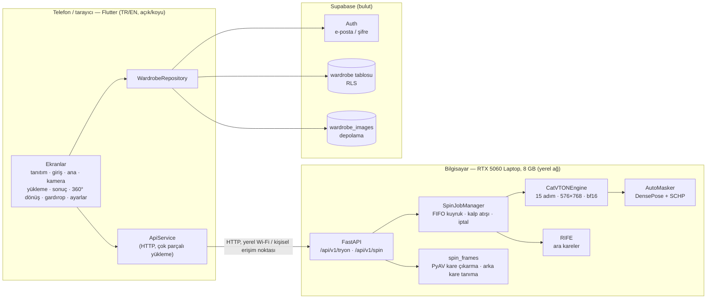
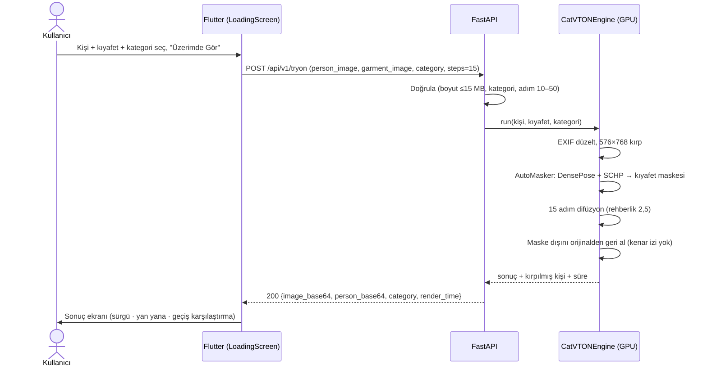
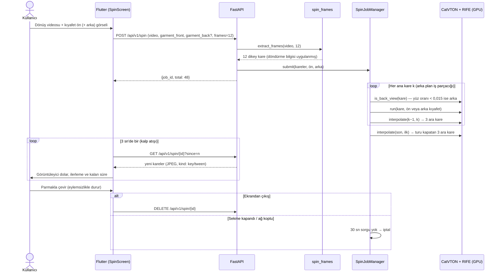
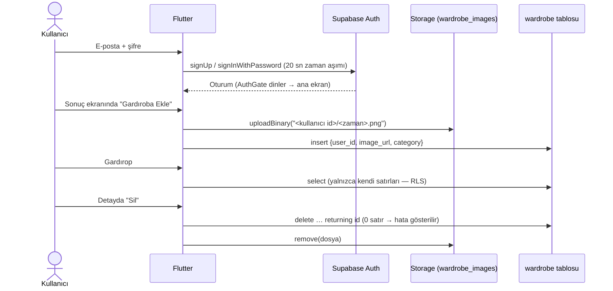
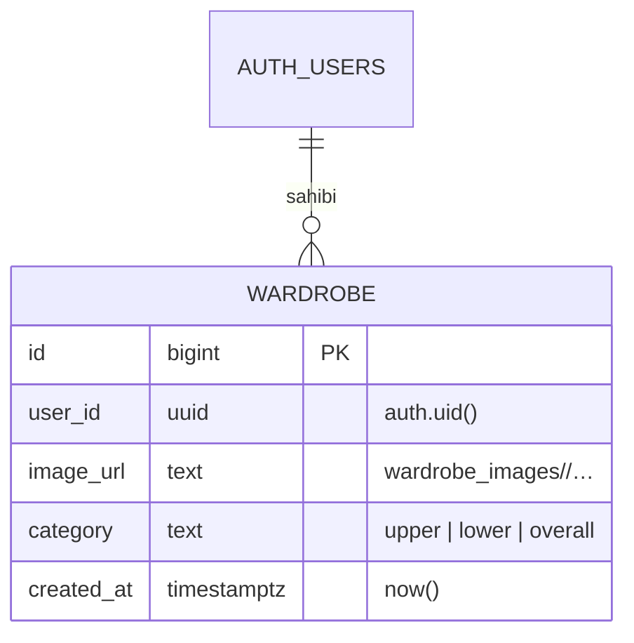
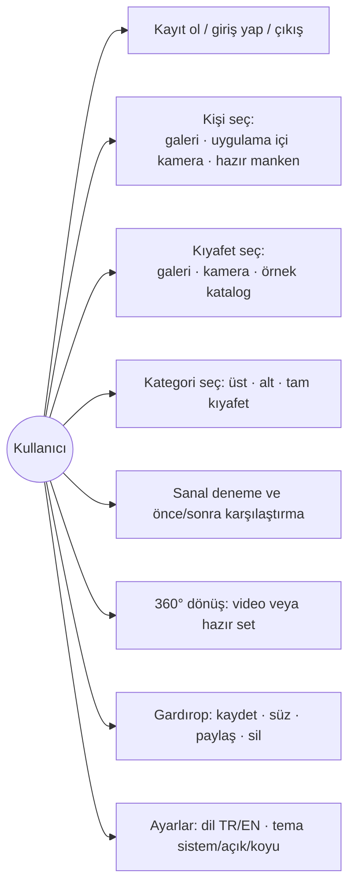

# SeeItOn – Mimari

SeeItOn üç parçadan oluşur: telefonda (veya tarayıcıda) çalışan **Flutter uygulaması**, aynı ağdaki bilgisayarda yerel GPU ile çalışan **FastAPI + CatVTON backend'i** ve kimlik doğrulama ile gardırobu tutan **Supabase**. Sanal deneme internete çıkmadan, yerel GPU'da yapılır; yalnızca giriş ve gardırop Supabase'e gider.

## 1. Bileşenler

| Parça | Teknoloji | Görev |
|---|---|---|
| Uygulama | Flutter 3, gen-l10n, `supabase_flutter`, `camera`, `image_picker` | Arayüz, kamera/galeri, durum, iki dil, iki tema |
| Backend | Python, FastAPI, PyTorch | İstekleri doğrular, görselleri hazırlar, modeli çalıştırır |
| Model | CatVTON (SD 1.5 inpainting tabanlı), DensePose, SCHP | Kıyafeti kişinin üzerine çizer; vücut maskesini çıkarır |
| Ara kare | RIFE (ECCV 2022, MIT) | 360° dönüşte ana kareler arasını doldurur |
| Veri | Supabase Auth, Postgres (RLS), Storage | Hesap, gardırop kayıtları, sonuç görselleri |

## 2. Tek fotoğraf denemesi

İstek eşzamanlıdır: uygulama yanıtı bekler (ölçülen ~8–17 sn), bu sırada yükleme ekranı tahmini ilerleme gösterir.

## 3. 360° dönüş

Uzun süren iş: backend bir iş numarası döner, uygulama 3 sn'de bir sorar ve hazır kareleri geldikçe gösterir.

## 4. Giriş ve gardırop

**Veri modeli ve güvenlik**

- Satır düzeyi güvenlik (RLS): `select`, `insert`, `delete` yalnızca `user_id = auth.uid()` için.
- Depolama: kullanıcı yalnızca kendi klasörüne (`<user_id>/…`) yükleyebilir, okuyabilir ve silebilir. Kurulum: `supabase/setup_wardrobe.sql`.

## 5. Kullanım senaryoları

## 6. Önemli tasarım kararları

| Karar | Gerekçe |
|---|---|
| IDM-VTON (Hugging Face Space) yerine yerel CatVTON | Uzak sıra ve zaman aşımları demo için güvenilir değildi; CatVTON 8 GB VRAM'e sığıyor ve alt giyimi de destekliyor |
| 15 adım · 576×768 · rehberlik 2,5 | Ölçüm: 73,6 sn → 16,8 sn; rehberliği kapatmak süreyi yarılar ama kumaş desenini siliyor (`tests/bench_speed.py`) |
| 360° için gerçek 3D yerine "dönüş videosu + kareler" | Görüntüden 3D modeller 8 GB'a sığmıyor ve yüz/desen kalitesi düşük; kare yaklaşımı gerçek fotoğraf kalitesini korur |
| 12 ana kare + RIFE ara kare | Akıcılık için kareler arası açı küçük olmalı; 48 kareyi tek tek giydirmek 4 kat uzun sürerdi |
| Uzun işler için iş numarası + sorgulama | Tarayıcıda (Safari) uzun açık bağlantı güvenilir değil; kalp atışı sahipsiz işleri temizler |
| Gardırop için Supabase + RLS | Hazır kimlik doğrulama ve dosya depolama; her kullanıcı yalnızca kendi verisini görür |

Bilinen sınırlar: [`docs/KNOWN_LIMITATIONS.md`](docs/KNOWN_LIMITATIONS.md).
